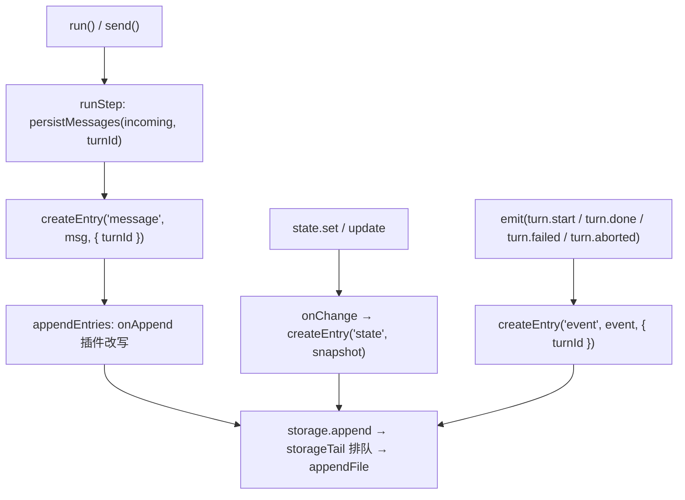

# 会话存储格式

`@yesimagent/core` 没有 `session` 对象，没有 `SessionManager`，也没有默认的会话目录。与「会话」等价的是每个 agent 一份 `AgentStorage` 条目流：`createAgent({ storage })` 把消息、状态快照和关键事件逐条追加进去，用 `createJsonlStorage(filePath)` 时这份流就是一个 JSONL 文件（`packages/core/src/storage.ts:33`）。本文沿用 session 这个词指代这份数据，通篇只讨论这条条目流本身。

版本基线：提交 `3f970ed` 的 `packages/core`，包版本 0.0.9。文中每个 `path:line` 都按这份源码核对过。

## 1. 定位与范围

覆盖：

- 条目流里有哪几种记录，每种记录的字段从哪里来、什么时候写入
- JSONL 文件的字节形态、追加语义、序列化顺序
- 读取、坏行处理、`init()` 重建、写入失败如何传播
- 用 jq 核对真实文件的命令与判据

不覆盖：

- AI SDK 的 `ModelMessage`、provider 选项、流式分片的内部格式；本文只说明 core 如何搬运它们
- `@yesimagent/gateway` 的协议转换与模型注册
- 插件实现细节；只在涉及写入拦截与读取改写时引用钩子签名
- `AgentState` 的业务字段含义；扩展字段由宿主用 declaration merging 定义（`packages/core/src/state.ts:1`）

## 2. 实现文件索引

| 位置                                 | 内容                                                        |
| ------------------------------------ | ----------------------------------------------------------- |
| `packages/core/src/storage.ts:6-10`  | `AgentStorage<T>` 接口：`append` / `read` / `clear`         |
| `packages/core/src/storage.ts:12-26` | `createMemoryStorage`：数组实现                             |
| `packages/core/src/storage.ts:28-32` | JSONL 实现的约束注释：单进程串行、全量解析、坏行报行号      |
| `packages/core/src/storage.ts:33-64` | `createJsonlStorage(filePath)`：追加、读取、清空            |
| `packages/core/src/entry.ts:5-9`     | `AgentCustomEntry`：`event` / `message` / `state` 三键      |
| `packages/core/src/entry.ts:11-13`   | `AgentEntry` 判别联合与基类字段                             |
| `packages/core/src/entry.ts:21-29`   | `createEntry`：`id`、`timestamp`、`turnId` 的生成规则       |
| `packages/core/src/message.ts:4-30`  | `AgentMessage` 五种 role 与 assistant 的额外元数据          |
| `packages/core/src/message.ts:37-71` | 各 role 的构造函数与 `id`、`timestamp` 默认值               |
| `packages/core/src/event.ts:10-23`   | `AgentEvent` 十三种事件的联合                               |
| `packages/core/src/event.ts:25-116`  | 每种事件的字段定义                                          |
| `packages/core/src/state.ts:3-5`     | `AgentState.version`                                        |
| `packages/core/src/state.ts:12-59`   | `AgentStateManager`：快照写入与串行提交                     |
| `packages/core/src/agent.ts:105-125` | 默认内存存储与 `storageTail` 串行队列                       |
| `packages/core/src/agent.ts:127-130` | 状态变更接到 `storage.append`                               |
| `packages/core/src/agent.ts:150-157` | `emit`：哪几种事件落盘                                      |
| `packages/core/src/agent.ts:159-168` | `appendEntries`：写入前的插件改写与 `message.appended` 广播 |
| `packages/core/src/agent.ts:170-188` | `persistMessages`：一条消息一条 entry，附 `turnId`          |
| `packages/core/src/agent.ts:190-204` | `collectModelMessages`：每个 step 全量读入                  |
| `packages/core/src/agent.ts:235-247` | `runStep`：先落盘入参消息，再组装模型输入                   |
| `packages/core/src/agent.ts:288-314` | 单个 step 的 assistant / tool 消息合并成一次追加            |
| `packages/core/src/agent.ts:383-408` | `ensureInit`：从最后一条 `state` 恢复                       |
| `packages/core/src/agent.ts:523-525` | `agent.clear()`：只清存储                                   |
| `packages/core/src/agent.ts:533-546` | `toModelMessage`：消息投影为 `ModelMessage`                 |
| `packages/core/src/turn.ts:283-359`  | `runTurn`：`turn.start` → 若干 step → 终结事件              |
| `packages/core/src/turn.ts:386`      | `turnId` 的生成点                                           |
| `packages/core/src/turn.ts:445-447`  | `totalUsage` 的累加规则                                     |

## 3. 落盘布局

- 没有默认路径。`createJsonlStorage(filePath)` 的 `filePath` 必填，取什么值完全由宿主决定（`packages/core/src/storage.ts:33`）。仓库里没有第二个调用点，也没有环境变量或配置项介入。
- agent 自己不创建文件。`createAgent` 在没有传入 `storage` 时用内存实现（`packages/core/src/agent.ts:105`），文件只在宿主显式构造 `createJsonlStorage` 后才存在。
- 目录在第一次非空追加时创建：`mkdir(path.dirname(filePath), { recursive: true })`（`packages/core/src/storage.ts:38`）。空数组追加直接返回，不触碰文件系统（`packages/core/src/storage.ts:36`）。
- `filePath` 没有目录部分时，`path.dirname` 得到 `"."`，`mkdir(".")` 成功且无副作用；相对路径按进程当前目录解析，因为 `appendFile` 与 `readFile` 直接使用该字符串（`packages/core/src/storage.ts:40,44`）。
- 一个文件对应一条条目流。没有按 agent、按天、按 turn 的分文件机制，也没有索引文件。

实测（`createJsonlStorage` 直接调用）：

```
EMPTY_APPEND_DIR_EXISTS: false
REAL_APPEND_DIR_EXISTS: true
```

## 4. 文件格式

行单位：一条 entry 一行，行内是紧凑 JSON，LF 结尾，UTF-8 编码（`appendFile(..., "utf8")` 与 `readFile(..., "utf8")`，`packages/core/src/storage.ts:40,44`）。

追加语义：

- 一次 `append(...entries)` 用 `JSON.stringify` 逐条序列化，再用 `"\n"` 连接，末尾补一个 `"\n"`，作为一次 `appendFile` 写入（`packages/core/src/storage.ts:39-40`）。
- 只追加，不重写既有行，不排序，不合并。文件顺序就是调用顺序。
- 空数组追加不写任何字节（`packages/core/src/storage.ts:36`）。

序列化顺序：`JSON.stringify` 按属性插入顺序输出，`createEntry` 的返回对象顺序固定为 `id`、`type`、`data`、`timestamp`，`turnId` 存在时排在最后（`packages/core/src/entry.ts:22-28`）。`data` 内部的键顺序由各构造函数决定，例如 assistant 消息为 `id`、`timestamp`、`role`、`content`，随后是 `usage`、`finishReason`、`provider`、`modelId`（`packages/core/src/message.ts:45-51`）。

编码细节：非 ASCII 字符按原样写入，样例里的中文直接以 UTF-8 出现；引号、反斜杠、控制字符按 JSON 规则转义。`undefined` 的键被 `JSON.stringify` 丢弃，所以 `turnId`、`reason`、`error`、`providerOptions` 这类可选字段在缺失时整键不出现，文件中不会看到 `"turnId": null`。

写入路径：



实测一次带两条记录的追加，落盘结果是三行、以换行结尾：

```
BATCH_BYTES: "6}\n"
BATCH_LINES: 4 | trailing newline: true
```

（`BATCH_LINES` 为 4，因为首条 `append` 写两行、第二条 `append` 写一行，`split("\n")` 末尾多出一个空串。）

## 5. 条目基类

```ts
// packages/core/src/entry.ts:11-13
export type AgentEntry<T extends keyof AgentCustomEntry = keyof AgentCustomEntry> = {
  [K in T]: { type: K; data: AgentCustomEntry[K]; id: string; timestamp: number; turnId?: string };
}[T];
```

| 字段        | 类型      | 生成规则                                                                       |
| ----------- | --------- | ------------------------------------------------------------------------------ |
| `id`        | `string`  | 默认 `crypto.randomUUID()`，可由 `CreateEntryOptions.id` 覆盖（`entry.ts:23`） |
| `type`      | 字面量    | `"event"` / `"message"` / `"state"` 三选一（`entry.ts:11-13`）                 |
| `data`      | 判别成员  | 由 `type` 决定的载荷（见第 6 章）                                              |
| `timestamp` | `number`  | 默认 `Date.now()`，毫秒（`entry.ts:26`）                                       |
| `turnId`    | `string?` | 只有传入时才写该键；`undefined` 时整键省略（`entry.ts:27`）                    |

两个容易混淆的身份：

- `entry.id` 是这一行的编号，每次落盘新生成。
- `data.id`（仅消息有）是消息自身的编号，由 `createUserMessage` 一类构造函数在调用时生成（`message.ts:66-70`），或由调用方通过 `CreateMessageOptions.id` 指定。
- 因此同一条消息的 `entry.id` 与 `data.id` 永远不同，排查时按哪个字段查要分清。

`entry.timestamp` 是落盘时刻，`data.timestamp` 是消息/状态对象的创建时刻，前者一般略晚（`persistMessages` 在 step 开始时才构造 entry，`agent.ts:181`）。`turnId` 的生成点是 `turn.ts:386`，每个 turn 一个新 UUID，队列、事件、条目共用这一个值。

## 6. 条目分类

样例来源说明：本章的样例取自同一份 18 行文件，由 `createAgent` + `createJsonlStorage(filePath)` 真实写入。模型用 `ai/test` 的 `MockLanguageModelV4` 驱动，存储的写入、读取、`init()` 恢复全部走 `packages/core/src` 的真实代码，没有替换 `AgentStorage`。文件覆盖四个 turn（成功两轮、失败一轮、中断一轮）和一条不带 turn 的输入。重新生成的步骤见 13.9。

### 6.1 message

一条消息一条 entry，`data` 就是 `AgentMessage`（`agent.ts:181`）。role 共五种，前四种继承 AI SDK 的模型消息类型，第五种 `custom` 只存在于 core（`message.ts:4-30`）：

```ts
// packages/core/src/message.ts:4-30
export interface AgentMessageBase { id: string; timestamp: number; }
export type CustomMessages<...> = { [K in T]: { role: "custom"; type: K; data: AgentCustomMessage[K] } & AgentMessageBase }[T];
export interface AgentUserMessage extends AgentMessageBase, UserModelMessage {}
export interface AgentSystemMessage extends AgentMessageBase, SystemModelMessage {}
export interface AgentAssistantMessage extends AgentMessageBase, AssistantModelMessage {
  provider?: string;
  modelId?: string;
  usage?: Partial<LanguageModelUsage>;
  finishReason?: string;
}
export interface AgentToolMessage extends AgentMessageBase, ToolModelMessage {}
export type AgentMessage = AgentUserMessage | AgentSystemMessage | AgentAssistantMessage | AgentToolMessage | CustomMessages;
```

字段表：

| 字段                  | 出现条件                    | 来源                                                                    |
| --------------------- | --------------------------- | ----------------------------------------------------------------------- |
| `role`                | 总是                        | `user` / `system` / `assistant` / `tool` / `custom`（`message.ts:30`）  |
| `id`                  | 总是                        | 消息构造函数，默认 `crypto.randomUUID()`（`message.ts:66-70`）          |
| `timestamp`           | 总是                        | 消息构造函数，默认 `Date.now()`（`message.ts:66-70`）                   |
| `content`             | 除 `custom` 外              | AI SDK 的 `UserContent` / `string` / `AssistantContent` / `ToolContent` |
| `type`、`data`        | 仅 `custom`                 | `createCustomMessage(type, data)`（`message.ts:58-64`）                 |
| `provider`、`modelId` | assistant，成功产出过响应时 | 本 step 运行用的模型快照（`agent.ts:288,302-303`）                      |
| `usage`               | assistant，成功产出过响应时 | `await response.usage` 的归一化计数字段（`agent.ts:291`）               |
| `finishReason`        | assistant，成功产出过响应时 | `await response.finishReason`（`agent.ts:292`）                         |
| `providerOptions`     | 模型消息带回时              | 原样搬运（`agent.ts:301,308`）                                          |

写入时机：

- turn 的入参消息在第一个 step 开始前写入，带该 turn 的 `turnId`（`agent.ts:237`）。
- 一个 step 产生的 assistant 消息与 tool 消息合并成一次 `append`，保证「调用」与「结果」在文件里相邻（`agent.ts:314`）。
- 运行中通过 `send` 加入的消息由 `flushJoined` / `flushTurnTail` 落盘，同样带当前 turn 的 `turnId`（`turn.ts:289-304`）。
- 没有触发 turn 的输入（`send(msg, { trigger: false })`）立即写入，不带 `turnId`（`agent.ts:496-499`），文件里不会出现对应的事件。
- 同一个消息对象重复提交不会重复写入：已落盘的对象记在 `WeakMap` 里，第二次直接复用已有条目（`agent.ts:134,174-180`）。

真实样例（成功 turn 的两条消息）：

```text
{"id":"f05decae-ffe0-4b21-9499-ff2c9484e597","type":"message","data":{"id":"fd1b9db4-ce7e-4486-b9df-f617770e9434","timestamp":1793529794041,"role":"user","content":"你好"},"timestamp":1793529794046,"turnId":"f1cea7a6-eced-4a6f-a005-57a656362e93"}
{"id":"97d018f1-f119-4c10-a278-be096e0ba7f9","type":"message","data":{"id":"8a1af173-5608-40bd-aae6-daa6bee55523","timestamp":1793529794071,"role":"assistant","content":[{"type":"text","text":"你好，我是助手。"}],"usage":{"inputTokens":12,"inputTokenDetails":{"noCacheTokens":12},"outputTokens":7,"outputTokenDetails":{"textTokens":7},"totalTokens":19},"finishReason":"stop","provider":"mock-provider","modelId":"mock-model-1"},"timestamp":1793529794071,"turnId":"f1cea7a6-eced-4a6f-a005-57a656362e93"}
```

带工具调用的 turn（assistant 的 tool-call 与 tool 结果紧邻，随后是新一步的文本回复）：

```text
{"id":"af3dcdd3-45df-4c9f-8a3a-4e3d6f202ce1","type":"message","data":{"id":"63ccddc0-43f1-412c-b586-17f60ab5510a","timestamp":1793529794094,"role":"assistant","content":[{"type":"tool-call","toolCallId":"call-weather-1","toolName":"weather","input":{"city":"杭州"}}],"usage":{"inputTokens":12,"inputTokenDetails":{"noCacheTokens":12},"outputTokens":7,"outputTokenDetails":{"textTokens":7},"totalTokens":19},"finishReason":"tool-calls","provider":"mock-provider","modelId":"mock-model-1"},"timestamp":1793529794094,"turnId":"e828bc3d-ef07-4191-85f5-034d543e43ad"}
{"id":"cf193885-2802-4eea-85ba-29a054a69df4","type":"message","data":{"id":"ad54dd65-dfd7-45be-95d5-d5a7a15b796a","timestamp":1793529794094,"role":"tool","content":[{"type":"tool-result","toolCallId":"call-weather-1","toolName":"weather","output":{"type":"json","value":{"city":"杭州","condition":"多云","low":18,"high":24}}}]},"timestamp":1793529794094,"turnId":"e828bc3d-ef07-4191-85f5-034d543e43ad"}
```

不带 turn 的输入：

```text
{"id":"8fa965e7-c712-4873-9447-a26bd03774e0","type":"message","data":{"id":"483418f0-2df6-47f1-b7fe-13397897038b","timestamp":1793529794136,"role":"user","content":"没有触发 turn 的输入"},"timestamp":1793529794136}
```

`usage` 的键随 provider 返回的字段变化，没有返回的键不出现；`inputTokens` 一类是数值，`inputTokenDetails`、`outputTokenDetails` 是明细对象。`raw` 只在 provider 提供时出现，不属于 core 定义的字段。

### 6.2 event

`AgentEvent` 共十三种（`event.ts:10-23`），落盘的只有四种：`turn.start`、`turn.done`、`turn.failed`、`turn.aborted`（`agent.ts:153`）。其余 `agent.init`、`agent.stop`、`turn.queued`、`turn.step`、`message.appended`、`tool.start` / `tool.done` / `tool.failed` / `tool.blocked` 只经 channel 与 turn 流分发，文件里不会出现。

| `data.type`    | 额外字段                | 产生位置                  | 语义                                            |
| -------------- | ----------------------- | ------------------------- | ----------------------------------------------- |
| `turn.start`   | `turnId`                | `turn.ts:308`             | turn 开始，在第一个 step 之前                   |
| `turn.done`    | `turnId`、`totalUsage?` | `turn.ts:338`             | 全部 step 结束；`totalUsage` 为各 step 用量之和 |
| `turn.failed`  | `turnId`、`error?`      | `turn.ts:348-352`         | 抛错；`error` 由 `serializeError` 生成          |
| `turn.aborted` | `turnId`、`reason?`     | `turn.ts:230-235,348-352` | 被中断；排队中的 turn 在中断时也补一条          |

`error` 形状固定为 `{ name, message, cause?, stack? }`（`turn.ts:433-444`）：`cause` 经 `String()` 转换，`stack` 为原始调用栈，两者缺失时整键不出现。`reason` 在活动 turn 上取 `error.message`（`turn.ts:349-350`），在排队 turn 上取 `String(reason)` 或 `Error.message`（`turn.ts:230-235`）。

真实样例：

```text
{"id":"3b133a64-161a-4f9e-93f4-879d6dec5dd7","type":"event","data":{"type":"turn.start","turnId":"f1cea7a6-eced-4a6f-a005-57a656362e93"},"timestamp":1793529794042,"turnId":"f1cea7a6-eced-4a6f-a005-57a656362e93"}
{"id":"2dc6bcfa-aeb1-41c6-941a-d40b17277daf","type":"event","data":{"type":"turn.done","turnId":"f1cea7a6-eced-4a6f-a005-57a656362e93","totalUsage":{"inputTokens":12,"inputTokenDetails":{"noCacheTokens":12},"outputTokens":7,"outputTokenDetails":{"textTokens":7},"totalTokens":19}},"timestamp":1793529794073,"turnId":"f1cea7a6-eced-4a6f-a005-57a656362e93"}
{"id":"8fc51438-3d17-4529-bcf3-13198f8722e3","type":"event","data":{"type":"turn.aborted","turnId":"f45a93ba-20b6-4c4e-a3f6-e2f7058a934e","reason":"user cancelled"},"timestamp":1793529794135,"turnId":"f45a93ba-20b6-4c4e-a3f6-e2f7058a934e"}
```

`turn.failed` 的真实行（`stack` 字段原值为调用栈字符串，此处省略）：

```text
{"id":"b67b60c7-985f-41a3-a9a8-1d54d9fc568d","type":"event","data":{"type":"turn.failed","turnId":"2b1a885a-1bac-420b-8540-73a5c7d10f04","error":{"name":"Error","message":"provider returned 500","stack":"…"}},"timestamp":1793529794125,"turnId":"2b1a885a-1bac-420b-8540-73a5c7d10f04"}
```

`totalUsage` 由 `addUsage` 逐字段累加，缺失的计数保持缺失，provider 的 `raw` 不进入合计（`turn.ts:445-447`）；单 step 的用量只出现在 `turn.step` 事件里，不落盘。

### 6.3 state

每次状态变更追加一份完整快照（`agent.ts:127-130` → `state.ts:36-41`）。没有增量、没有 diff，`data` 就是整份 `AgentState`。默认形状只有 `version`（`state.ts:3-5`），宿主用 declaration merging 扩展 `AgentCustomState` 后可带任意字段（`state.ts:1`）。

| 字段           | 说明                                                          |
| -------------- | ------------------------------------------------------------- |
| `data.version` | 宿主自定义的版本号，core 只在默认值里写 `1`（`agent.ts:128`） |
| 其他字段       | 由 `AgentCustomState` 的声明决定                              |

state 条目没有 `turnId`：变更可能发生在 turn 之外，也不与某个 turn 绑定（`agent.ts:129` 的 `createEntry` 只传了 `type` 与 `data`）。

真实样例（第 5 行，`version` 从默认的 1 改为 2 后写入）：

```text
{"id":"0b6eb07c-66ab-44b8-b91d-487142bc7bb2","type":"state","data":{"version":2},"timestamp":1793529794073}
```

初始状态不写入文件：`initialState` 只在内存里生效，第一次 `state.set` / `state.update` 才落盘（`state.ts:36-41`，`agent.ts:127-130`）。因此没有发生过状态变更的 agent，文件里一条 state 条目都没有。

## 7. 版本与迁移

当前只有一处版本字段：`AgentState.version`，类型 `number`，定义在 `state.ts:3-5`。它在数据内部，属于业务快照的一部分。core 自己不读取这个值：全仓库对 `version` 的引用只有类型定义与默认值 `{ version: 1 }`（`state.ts:4`，`agent.ts:128`），没有任何比较、校验或分支。

不存在的东西，逐条写明：

- 文件级版本位：JSONL 里没有 `{"type":"header"}` 之类的元数据行，也没有注释行。
- 迁移机制：没有 upgrade/downgrade 函数，没有按版本分派的解析器；`read()` 直接把每行 `JSON.parse` 后断言为 `AgentEntry`（`storage.ts:49`），不做类型校验。
- 分支与叶子指针：没有 `parentId`、`branch`、`leaf` 之类字段，条目之间只靠文件顺序与 `turnId` 关联。
- 压缩摘要条目：没有摘要类型，也没有替换既有行的机制。
- 内容外置：消息体、工具结果、错误栈都直接写在行内，没有 `blob` 引用。
- 跨进程写锁：没有锁文件、没有 `flock`，`storage.ts:28-32` 的注释明确写出「appends are serialized within one agent but not across processes」。

由此产生的排查盲区：

- 拿到一份文件无法判断它由哪个版本的 core 写出。字段形状变化后，旧文件会被新代码按当前形状解释，缺字段的地方表现为 `undefined`，多出来的字段被静默忽略。
- `version` 只反映宿主最后一次写入时的值，不保证与条目格式匹配；宿主如果从不修改 state，文件里连这个数字都没有。
- 新增条目类型可以安全写入（`AgentEntry` 是开放联合），但读取方只认 `message` / `event` / `state` 三种用法，未知 `type` 会被 `collectModelMessages` 的过滤丢弃（`agent.ts:193`），不会报错，也不会进入模型上下文。

## 8. 加载与兼容行为

`read()` 的实现是一次性读取全文、按 `"\n"` 切分、逐行解析（`storage.ts:42-59`）。行为按下表确定：

| 情况                       | 行为                                                                        | 来源                         |
| -------------------------- | --------------------------------------------------------------------------- | ---------------------------- |
| 文件不存在                 | 返回空数组，不创建文件                                                      | `storage.ts:55-57`（ENOENT） |
| 文件为空（0 字节）         | 返回空数组                                                                  | `storage.ts:46-47`           |
| 空行（长度为 0）           | 跳过，不计入结果                                                            | `storage.ts:47`              |
| 只含空白的行               | 解析失败，抛 `SyntaxError`                                                  | `storage.ts:47-51`，实测下文 |
| 坏行（残缺 JSON）          | 抛 `SyntaxError("Invalid JSON at line N: <运行时解析错误>")`，`N` 从 1 开始 | `storage.ts:49-51`           |
| 最后一行没有换行           | 正常解析；`split` 产出的最后一个元素就是该行                                | `storage.ts:46`              |
| 其他 IO 错误（权限、占用） | 原样抛出                                                                    | `storage.ts:57`              |
| 未知 `type` 或字段缺失     | 原样返回，不做校验；后续按调用点各自的过滤逻辑处理                          | `storage.ts:49`              |

实测（真实文件行为）：

```
CORRUPT_ERROR: SyntaxError | Invalid JSON at line 4: JSON Parse error: Expected '}'
SPACED_LINE: Invalid JSON at line 2: JSON Parse error: Unexpected EOF
MISSING_READ: []
BLANK_LINES_RESULT: [{"id":"ea03f8fe-ee7a-4bfb-ab5b-aa1d3869f8c0","type":"state","data":{"version":3},"timestamp":1793529833147}]
CLEAR_MISSING_OK
```

冒号后的解析错误文本来自运行时的 `JSON.parse`（上例是 Bun），前缀 `Invalid JSON at line N:` 由 core 固定拼接，`N` 是 `split("\n")` 之后的 1 基下标。

`clear()` 等价于 `rm(filePath, { force: true })`（`storage.ts:60-62`）：文件不存在也算成功，目录保留。

读失败的影响面比「一次读取」大得多：`init()` 会读（`agent.ts:392`），每个 step 组装模型输入时也会读（`agent.ts:191`）。文件一旦出现坏行，`init()` 直接拒绝，turn 在第一个 step 之前就失败，错误经第 10 章的路径变成 `turn.failed`。

## 9. 重建语义

`init()` 的恢复步骤（`agent.ts:383-408`）：

1. 读取整个存储，取最后一条 `type === "state"` 的条目（`agent.ts:392`）。
2. 有则 `state.restore(entry.data)`，整份替换内存快照（`agent.ts:393`，`state.ts:22-24`）。
3. 没有则保留构造时传入的 `initialState`，也就是 `config.initialState ?? { version: 1 }`（`agent.ts:128`）。
4. 依次初始化插件，成功后广播 `agent.init`（`agent.ts:394-399`）。该事件不落盘。

恢复的只有 state。消息不进入任何内存结构：每个 step 都从存储重新读一遍全部条目（`agent.ts:191`），按 `type === "message"` 过滤（`agent.ts:193`），再经两层插件钩子，最后投影成 AI SDK 的 `ModelMessage`：

- `transformEntries` 拿到全部条目，可以增删改（`agent.ts:192`，签名 `plugin.ts:110`）。
- `transformMessages` 拿到消息数组，再做一轮改写（`agent.ts:194`，签名 `plugin.ts:111`）。
- `role === "custom"` 的消息交给 `toModelMessages` 钩子投影，钩子返回空则该消息不进上下文（`agent.ts:197-202`）。
- 其余 role 由 `toModelMessage` 逐字段搬运：`user` / `system` 取 `content`，`assistant` / `tool` 额外带上存在的 `providerOptions`（`agent.ts:533-543`）。遇到未知 role 直接抛 `Unsupported message role`（`agent.ts:544`），该 step 失败。

`turnId` 不参与重建：消息按文件顺序全部进入上下文，与它属于哪个 turn 无关。`data.id`、`entry.id` 都不参与，模型看到的是投影后的内容。

实测：用上文 18 行样例调用 `agent.init()`，结果为 `{"version":2}`，条目总数 18，与文件一致。

## 10. 持久化保证与失败模型

写入串行化：`createAgent` 把宿主传入的存储包一层，`append`、`read`、`clear` 全部排进 `storageTail` 这条 Promise 链（`agent.ts:106-125`）。链上某次操作失败不影响后续操作入队，因为尾巴在两种结果上都继续（`agent.ts:110-113,119-122`）。这层保证的作用范围是单个 agent 实例、单个进程：

- 两个 agent 写同一个文件路径：两套队列互不可见，写顺序无法保证。
- 多进程写同一个文件：没有任何锁，`storage.ts:28-32` 的注释把这条限制写明。
- 没有 `fsync`，没有临时文件加原子替换。进程在写入过程中崩溃或断电，可能留下半行；下次 `read()` 会以坏行报错（第 8 章），这就是「文件末尾突然报 Invalid JSON」的常见来由。

失败传播实测（用一个在第 N 次写入时抛错的 `AgentStorage` 驱动真实 turn）：

| 失败位置                   | 消费方看到的 turn 事件                                | 文件里留下的条目                                              |
| -------------------------- | ----------------------------------------------------- | ------------------------------------------------------------- |
| 第一次写入（`turn.start`） | `turn.start`, `turn.queued`, `turn.failed`            | `event:turn.failed`                                           |
| 第二次写入（用户消息）     | `turn.start`, `turn.queued`, `turn.failed`            | `event:turn.start`, `event:turn.failed`                       |
| 第四次写入（`turn.done`）  | `turn.start`, `turn.queued`, `turn.step`, `turn.done` | `event:turn.start`, `message`, `message`, `event:turn.failed` |

前两行的路径：`emit` 里 `storage.append` 拒绝 → 沿 `runTurn` 的 `await` 抛出 → `catch` 把状态判成 `failed`（`turn.ts:340`）→ 广播 `turn.failed`（`turn.ts:348-352`），该事件本身若能写入就进文件，若写不进去，异常继续从 `runTurn` 抛出。

第三行暴露一个必须知道的行为：`emit` 先把事件推进 turn 流，再写存储（`agent.ts:151-155`）。`turn.done` 已经推给消费方、流随即关闭，之后写盘失败才发生；`catch` 补写的 `turn.failed` 没有任何监听者。结果是「消费方看到成功，文件里记着失败」。用 jq 排查时，这种文件表现为最后一条 turn 事件是 `turn.failed`，而同一 `turnId` 没有 `turn.done`。

状态写入失败：`state.set` / `state.update` 返回的 Promise 直接拒绝，内存里的 state 不更新（`state.ts:37-41` 的 `apply` 里先 `await onChange` 再赋值）。仓储层测试 `packages/core/tests/state.spec.ts:6-20` 覆盖了这条路径。

`agent.clear()` 只调用 `storage.clear()`（`agent.ts:523-525`）：文件被删除，内存里的 state 不变，下一次 `state.update` 会写出包含完整字段的新快照。清空与追加共用同一条队列（`agent.ts:117-124`），因此不会出现「清空之后旧追加又写回」的顺序错乱。

## 11. 数据规模控制

当前没有任何规模控制机制：

- 没有截断：条目写入多少就保留多少。
- 没有摘要或压缩条目：没有把多轮历史折叠成一条的类型。
- 没有内容外置：工具结果、错误栈整段写在行内。
- 没有轮转、分片、索引：一个文件就是全部历史。

唯一的成本控制点在读取侧与写入侧的插件钩子：

- 写前 `onAppend` 可以改写或丢弃待写入的条目（`agent.ts:161`，签名 `plugin.ts:109`）。
- 读时 `transformEntries` / `transformMessages` 每个 step 都会跑（`agent.ts:192-194`），裁剪只影响本次模型输入，文件不变。

每个 step 都全量读取文件（`agent.ts:191`），所以每步的读取成本与文件长度线性相关，模型输入长度也随历史增长，除非插件裁剪。`storage.ts:29-31` 的注释给出的结论是：文件大到扫描不动时，应当换成数据库一类的宿主后端。

## 12. 存储抽象

```ts
// packages/core/src/storage.ts:6-10
export interface AgentStorage<T = AgentEntry> {
  append(...entries: T[]): Promise<void> | void;
  read(): Promise<Readonly<T[]>> | Readonly<T[]>;
  clear(): Promise<void> | void;
}
```

契约要点：

- `append`、`read`、`clear` 都允许同步或异步实现；agent 包装层统一按 Promise 排队（`agent.ts:107-125`）。
- `read` 返回只读数组。两种内置实现都返回新数组，调用方修改返回值不会影响存储内部（`storage.ts:19-21,49-54`）。
- `append` 一次可传任意条数，实现需保持传入顺序（`storage.ts:39`）。
- 传入自定义存储接管的字段是 `AgentEntry`，agent 侧不做二次包装以外的额外校验。

两种内置实现的差异：

| 维度           | `createMemoryStorage`（`storage.ts:12-26`） | `createJsonlStorage`（`storage.ts:33-64`）     |
| -------------- | ------------------------------------------- | ---------------------------------------------- |
| 数据位置       | 进程内数组                                  | 磁盘文件                                       |
| 同步性         | 全部同步                                    | 全部异步                                       |
| `read` 结果    | 数组浅拷贝                                  | 每行 `JSON.parse` 的新对象                     |
| 文件不存在     | 不适用                                      | 返回空数组，不创建文件（`storage.ts:55-57`）   |
| 坏数据         | 无（内存里只有代码写入的对象）              | `SyntaxError`，带 1 基行号（`storage.ts:51`）  |
| `clear`        | 数组清空                                    | 删除文件，不存在也算成功（`storage.ts:60-62`） |
| 目录           | 无                                          | 首次非空追加时 `mkdir -p`（`storage.ts:38`）   |
| 重启后是否保留 | 否                                          | 是                                             |
| 跨进程共享     | 不适用                                      | 不支持，无锁（`storage.ts:28-32`）             |

`createAgent` 未传 `storage` 时使用内存实现（`agent.ts:105`），因此默认配置下进程退出即丢失全部历史。

## 13. 核对与排查手册

以下命令都在真实文件上跑过，输出原样粘贴。示例文件为 18 行 `session.jsonl`（来源见 6 章开头），`jq` 版本 1.8.2。

### 13.1 统计各类条目数量

```bash
jq -r '.type' session.jsonl | sort | uniq -c
```

```
      8 event
      9 message
      1 state
```

细分事件种类：

```bash
jq -r 'select(.type=="event") | .data.type' session.jsonl | sort | uniq -c
```

```
      1 turn.aborted
      2 turn.done
      1 turn.failed
      4 turn.start
```

判据：`turn.done` + `turn.failed` + `turn.aborted` 的数量应当等于 `turn.start`；不等就说明有 turn 没写完（见 13.5）。`state` 的行数应当等于状态变更次数；为 0 表示从未调用过 `state.set` / `state.update`（见 13.7）。

### 13.2 按 turnId 重建一条 turn 的时间线

```bash
jq -c 'select(.turnId=="e828bc3d-ef07-4191-85f5-034d543e43ad") | {timestamp, type, detail: (.data.type // .data.role)}' session.jsonl
```

```
{"timestamp":1793529794074,"type":"event","detail":"turn.start"}
{"timestamp":1793529794074,"type":"message","detail":"user"}
{"timestamp":1793529794094,"type":"message","detail":"assistant"}
{"timestamp":1793529794094,"type":"message","detail":"tool"}
{"timestamp":1793529794114,"type":"message","detail":"assistant"}
{"timestamp":1793529794117,"type":"event","detail":"turn.done"}
```

判据：`turn.start` 在首行，终结事件在末行；assistant 的 `tool-call` 后紧跟同 `toolCallId` 的 `tool` 消息；`turn.done` 的 `timestamp` 不早于该 turn 最后一条消息。

### 13.3 查看最后一个 state 快照与版本

```bash
jq -s -c 'map(select(.type=="state")) | last' session.jsonl
jq -s -r 'map(select(.type=="state")) | last | .data.version' session.jsonl
```

```
{"id":"0b6eb07c-66ab-44b8-b91d-487142bc7bb2","type":"state","data":{"version":2},"timestamp":1793529794073}
2
```

判据：`last` 是 `init()` 恢复用的那一份（`agent.ts:392-393`）。想知道进程重启后会恢复成什么，就看这一行，不要看第一条。

### 13.4 定位坏行

`jq` 整文件解析会在第一条坏记录处停下，退出码为 5：

```bash
jq -c . corrupt.jsonl > /dev/null
```

```
jq: parse error: Unfinished JSON term at EOF at line 5, column 0
```

提示只有「文件读完时仍不完整」，看不出具体在哪一行。逐行扫描可以精确定位：

```bash
awk 'NF { print NR "\t" $0 }' corrupt-mid.jsonl | while IFS=$'\t' read -r n line; do printf '%s' "$line" | jq -e . >/dev/null 2>&1 || echo "bad line: $n"; done
```

```
bad line: 5
```

`core` 自己的加载器给出的行号与这里一致，且附带解析器原文：

```
SyntaxError: Invalid JSON at line 5: <运行时 JSON.parse 的错误文本>
```

修复方式只有一种：删掉该行，或把它补成完整 JSON。截断发生在文件末尾时（写入过程中断），删除末尾残行即可；`read()` 会把删剩的内容当作完整文件加载。

### 13.5 异常一：有 `turn.start` 没有终结事件

```bash
jq -s -r 'group_by(.turnId // "<no-turnId>")
  | map(select(([.[] | select(.type=="event") | .data.type] | index("turn.start"))
      and (([.[] | select(.type=="event") | .data.type]
        | any(. == "turn.done" or . == "turn.failed" or . == "turn.aborted")) | not)))
  | .[] | .[0].turnId // "<no-turnId>"' truncated.jsonl
```

真实输出（`truncated.jsonl` 为样例前 13 行，第 14 行的 `turn.failed` 被去掉）：

```
2b1a885a-1bac-420b-8540-73a5c7d10f04
```

完整样例文件上该命令无输出，说明没有此类异常。

检查步骤：

1. 看该 `turnId` 的事件序列有多长。只有 `turn.start`、随后是消息，通常是进程在 turn 执行中退出。
2. 若是正常结束的 turn 却缺少 `turn.done`，回看第 10 章第三行实验：终态事件的写入失败会让文件里只剩补写的 `turn.failed`。
3. 确认文件末尾没有残行（13.4），排除「终态事件写了半条」。
4. 该 turn 的消息仍然有效，模型上下文会照常读到它们（第 9 章），重建时不需要补事件。

### 13.6 异常二：有消息但没有对应的 turn 事件

```bash
jq -s -r 'group_by(.turnId // "<no-turnId>")[]
  | select(([.[] | select(.type=="message")] | length) > 0
    and ([.[] | select(.type=="event")] | length) == 0)
  | (.[0].turnId // "<no-turnId>")' session.jsonl
```

```
<no-turnId>
```

判据：`<no-turnId>` 表示这些消息在写入时不带 `turnId`，对应 `send(msg, { trigger: false })` 或不带触发标记的输入（`agent.ts:496-499`）。这是预期行为：输入先入档，等下一次 `continue` 或 `run` 才开始 turn。带具体 `turnId` 却没有任何事件，才是异常，通常意味着事件写入失败（第 10 章）。

### 13.7 异常三：state 快照缺失

```bash
jq -s '[.[] | select(.type=="state")] | length' session.jsonl
```

```
1
```

去掉样例第 5 行后的同一命令：

```
0
```

判据与处理：

- 计数为 0：agent 从未修改过状态，`init()` 会落到 `initialState`（`agent.ts:128,392-393`）。如果宿主依赖持久化状态，说明它没有调用 `state.set` / `state.update`，或者调用了但写入失败。
- 计数大于 0 但版本不是预期值：宿主写过该版本；core 不做校验（第 7 章），问题在调用方。
- 最后一条 state 早于某些消息：正常现象，状态与消息是两条独立序列，没有共同序号。

### 13.8 样例行数校验

```bash
wc -l session.jsonl
```

```
18 session.jsonl
```

`wc -l` 统计换行符数量，等于条目数，因为每次写入都以 `\n` 结尾（`storage.ts:40`）。数字不匹配时优先怀疑末尾残行。

### 13.9 重新生成样例文件

样例的生产方式：`createAgent` 配 `createJsonlStorage(filePath)`，模型用 `ai/test` 的 `MockLanguageModelV4` 依次回放四个响应（文本、工具调用、文本、错误），另起一个 turn 触发后立即 `interrupt("user cancelled")`，最后 `send(msg, { trigger: false })` 写入一条无 turn 的输入。模型只是响应来源，存储写入、读取、`init()` 恢复都由 `packages/core/src` 的真实代码完成，样例中不存在任何伪造的行。

复现要点：

```ts
const storage = createJsonlStorage("session.jsonl");
await storage.clear();
const agent = createAgent({ model, storage, tools: { weather } });
for await (const _ of agent.run(createUserMessage("你好"))) void _;
await agent.state.update({ version: 2 });
```

要让 `turn.failed` 出现，让模型流回放一个 `{ type: "error", error: new Error("provider returned 500") }` 分片（`agent.ts:225-228` 会把该分片抛出）；要让 `turn.aborted` 出现，在 turn 运行中调用 `agent.interrupt(reason)`。
